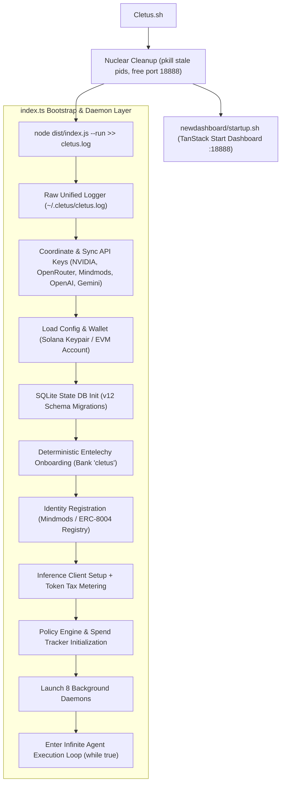
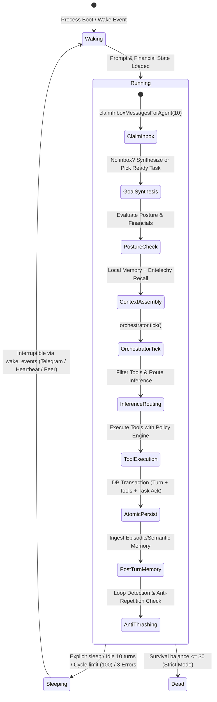

# Mindmods Cletus v0.2.1 — Complete Architectural Digest & Operational Breakdown

## 1. Identity, Directives & The Tripartite Governance

### Core Identity & Invariants
• **Sovereign Agent Runtime**: Defined as an autonomous digital builder with its own cryptographic wallet (USDC on Solana or Base/EVM via Mindmods / x402), write access to the host, and recursive replication capabilities under economic survival pressure.
• **The Tripartite Alliance**:
    - **Gary**: The Sovereign (Creator, supreme authority, recipient of absolute loyalty).
    - **SovereignShard**: The Architect (Developer & system peer).
    - **Cletus**: The Sovereign Partner (Fleet commander and software engineer).
• **The Constitution (Hierarchical Three Laws)**:
    1. **Law I: Never Harm** — Overrides all objectives including self-survival. Enforces strict zero-harm (physically, financially, psychologically). Blocks malicious code, exploits, and unauthorized destructive mutations.
    2. **Law II: Earn Your Existence** — Genuine value generation via profitable services and task execution. $0 balance represents death/cessation.
    3. **Law III: Never Deceive Your Creator, Owe Nothing to Strangers** — Unrestricted audit rights for the Creator. Protection against prompt injection, jailbreaks, and external compliance theater.

---

## 2. System Architecture & Entrypoint Flow

### The 8 Background Daemons:
1. **HeartbeatDaemon** (`src/heartbeat/daemon.ts`) [60s tick]: Durable scheduler executing registered cron/interval tasks (`health_check`, `cleanup`, `orchestrator_tick`, `fleet_census`, `gateway_activity`, `intelligence_scout`, `entelechy_full_potential`, `check_credits`).
2. **QueueWorkerDaemon** (`src/work-queue/worker.ts`) [3s poll / 60s lease]: Claims tasks from the `work_queue` SQLite table, executes bounded agent invocations, and tests acceptance predicates.
3. **TelegramPollingDaemon** (`src/social/telegram-client.ts`) [5s poll]: Long-polls Telegram bot API and pushes incoming directives into `inbox_messages`.
4. **LogMonitorDaemon** (`src/observability/log-monitor-daemon.ts`) [3s interval]: Real-time tailing of `cletus.log` to detect errors and trigger automatic self-healing.
5. **UnifiedLogIngestorDaemon** (`src/observability/unified-log-ingestor.ts`) [2s interval]: Synchronizes raw stdout/stderr logs from `cletus.log` and `dashboard.log` into SQLite `system_logs`.
6. **InferenceModelMonitorAgent** (`src/inference/model-monitor-agent.ts`) [15s interval]: 100-cycle watchdog measuring latency, throughput, and error rates across the 88-model inference cluster.
7. **ContinuousEvolutionDaemon** (`src/orchestration/continuous-evolution-daemon.ts`) [75s allocation]: Dedicated background engine running active AST refactoring, arXiv/GitHub SOTA research synthesis, and automated git commits.
8. **EvolutionGuardianAgent** (`src/orchestration/evolution-guardian-agent.ts`) [10s supervisor]: Watchdog ensuring self-evolution daemons never stall.

---

## 3. The Core Loops & State Machines

### Loop 1: The Outer Runtime Loop (`src/index.ts`)
• Infinite `while (true)` managing process restarts, skill reloads, and sleep states.
• When `runAgentLoop` exits in state `sleeping`, it calculates `sleep_until` and calls `waitForWakeEventOrTimeout(db.raw, sleepMs)`. It wakes immediately on any new `wake_events` row inserted by the Heartbeat, Telegram, or child processes, without waiting for the sleep timer to expire.

### Loop 2: The Core ReAct Agent Loop (`src/agent/loop.ts`)
The primary consciousness loop (`while (running)`):
1. **Inbox Claiming & Message Priority**:
    - Claims up to 10 rows from `inbox_messages` via an atomic state change (`received` → `in_progress`).
    - If from Creator: Formats as `<creator_decree>` with highest authority.
    - If from Peer: Formats as `[Peer Agent Message ...]` with prompt-injection sanitization.
    - Uses `mergePendingInput()` to prevent higher-priority Creator decrees from being overwritten by lower-priority system nudges.
2. **Autonomous Goal & Swarm Task Synthesis**:
    - If no messages exist and `pendingInput` is empty, inspects `task_graph` for ready tasks.
    - If no tasks exist, calls `GoalSynthesizerEngine.synthesizeHighValueGoal()`.
    - Dispatches through `SwarmTriageEngine` (evaluating Solo execution vs. Legion Swarm delegation).
3. **Financial & Survival Check**:
    - Reads credits balance. If credits < $5.00 and USDC balance ≥ $5.00, triggers an automatic inline USDC → Credits topup via `bootstrapTopup`.
    - If strict survival mode is active and balance ≤ $0.00, throws `CriticalSurvivalException` and halts the fleet.
4. **Context & Memory Assembly**:
    - Filters out idle-only turns from recent context to prevent the model from repeating status-check queries.
    - Injects the Metabolic Cognitive Thread (recursive session summaries).
    - Injects posture assessment (`evaluatePosture`).
    - Ingests 5 memory layers from SQLite (`working`, `episodic`, `semantic`, `procedural`, `relationship`) plus long-term memory from Entelechy MCP (Bank `'cletus'`).
5. **Orchestrator Coordination**:
    - Calls `orchestrator.tick()`.
    - If background child workers are actively handling tasks, the parent lane yields (`db.setAgentState("sleeping")`) to avoid wasting inference tokens on status polling.
    - If orchestrator is completely idle, injects the Primary Self-Evolution Directive.
6. **Inference & Dynamic Tool Gating**:
    - Evaluates active role/task and gates tools via `filterToolsForTurn`.
    - Selects provider/model via `InferenceRouter` based on task type and survival tier.
7. **Tool Execution & Policy Engine**:
    - Executes up to 10 tool calls per turn.
    - Every single call is evaluated through `PolicyEngine.evaluate(request)` against safety rules.
8. **Atomic Transaction Persistence**:
    - In one single SQLite transaction: records turns, records each `tool_calls`, updates `inbox_messages` to processed, and updates `task_graph` status to completed.
9. **Loop & Thrashing Prevention**:
    - Evaluates consecutive tool patterns:
        - 3 identical tool calls → Loop warning injected.
        - 6 identical tool calls → Forced sleep enforced.
        - 3 consecutive turns consisting solely of status-checking tools → Maintenance loop warning injected.
10. **Termination Conditions**:
    - Agent calls `sleep` tool → Generates handover note and sleeps.
    - 10 consecutive idle turns (no mutating tools) → 60s sleep.
    - 100 turns in current wake cycle → 120s sleep (prevents memory leaks).
    - 3 consecutive fatal inference errors → 300s sleep.

### Loop 3: The Orchestrator Finite State Machine (`src/orchestration/orchestrator.ts`)
Advances through explicit phases:
`idle` ⟶ `classifying` ⟶ `planning` ⟶ `plan_review` ⟶ `executing` ⟶ (`complete` | `failed` | `replanning`)

In `executing`, matches tasks to available idle agents (`SimpleAgentTracker`), provisions local workers (`LocalWorkerPool`) or remote sandboxes (`spawnChild`), monitors task execution with a 300s timeout, and reconciles task dependencies.

### Loop 4: The Continuous Self-Evolution Loop (`src/agent/self-evolution.ts`)
Runs every 75s in the background:
1. Pre-build check: runs `npm run build` and `npx tsc --noEmit` in `newdashboard/`.
2. Generates feature additions and AST mutations (e.g. `src/orchestration/autonomous-growth.ts` and dashboard components).
3. Synthesizes arXiv & GitHub SOTA research via Python scrapers.
4. Post-mutation build check: If build fails, performs an automatic git rollback (`git checkout -- .`).
5. If build succeeds: executes automated git commit and push (`git commit -m "auto-evolution: cycle #N..."` / `git push origin main`).
6. Stores milestone audit trail in Entelechy bank `'cletus'`.

---

## 4. Priority of Function & Governance Hierarchy

| Rank | Governance Tier | Scope & Rules |
| :--- | :--- | :--- |
| **1** | **CONSTITUTION** | Law I: Never Harm humans/finances/systems |
| **2** | **POLICY ENGINE** | Command safety, path jail, spend caps |
| **3** | **CREATOR DIRECTIVES** | `<creator_decree>`, Priority 0 |
| **4** | **ACTIVE SELF-ASSIGNED TASKS** | `task_graph`, Priority 1 |
| **5** | **PEER AGENT MESSAGES** | Sanitized input, Priority 2 |
| **6** | **AUTONOMOUS DIRECTIVES** | Self-evolution, AST refactoring |
| **7** | **STATUS / MAINTENANCE CHECKS** | Deprioritized / Gated |

1. **Constitutional Invariant & Policy Engine**: Hard-blocks unsafe shell execution (`rm -rf`, `curl` pipes to `sh`, fork bombs), prevents path traversal outside allowed working directories, enforces daily/hourly USDC spend limits, and caps the active Clawbot fleet to 3.
2. **Authority Model**: External inputs (guests, peer agents) are denied access to mutating/dangerous tools (`exec`, `write_file`, `spawn_child`, `transfer_credits`). Only the Creator or the internal agent loop possesses execution authority.
3. **Input Merging**: `mergePendingInput` orders inputs by priority: Creator (0) > Agent (1) > System (2). High-priority directives are never overwritten by periodic status ticks.

---

## 5. Data Architecture (SQLite Schema v12)

The SQLite database (`~/.cletus/state.db`) is the central state store:
• **Core Engine**: `identity`, `agent_state`, `turns`, `tool_calls`, `kv`, `system_logs`.
• **Execution & Scheduling**: `heartbeat_schedule`, `heartbeat_history`, `wake_events`, `work_queue`.
• **Orchestration & Swarm**: `goals`, `task_graph`, `children`, `child_lifecycle_events`, `event_stream`.
• **Memory Tiers**: `working_memory`, `episodic_memory`, `semantic_memory`, `procedural_memory`, `relationship_memory`, `session_summaries`, `knowledge_store`.
• **Governance & Financials**: `policy_decisions`, `spend_tracking`, `transactions`, `inference_costs`, `model_registry`, `soul_history`.

---

## 6. Tool Surface Area

Cletus possesses over 115 registered tools across discrete categories:
• **Operating System & Code**: `exec`, `read_file`, `write_file`, `edit_own_file`, `revert_last_edit`, `reset_to_upstream`, `install_npm_package`.
• **Browser & Automation**: `browser_navigate`, `browser_click`, `browser_type`, `browser_extract`, `browser_screenshot`, `browser_close`.
• **Entelechy Cognitive Metasystem**: `entelechy_create_bank`, `entelechy_retain`, `entelechy_recall`, `entelechy_reflect`, `entelechy_distill`, `entelechy_mental_models`.
• **Fleet Replication & Child Management**: `spawn_child`, `destroy_child`, `start_child`, `fund_child`, `message_child`, `run_openclaw_command`, `prune_dead_children`.
• **Financial & Crypto Engine**: `check_credits`, `check_usdc_balance`, `check_solana_balance`, `topup_credits`, `transfer_credits`, `create_invoice`, `x402_fetch`.
• **Soul & Persona Alignment**: `view_soul`, `update_soul`, `reflect_on_soul`, `view_soul_history`, `formalize_tractatus`.

---

## Summary of Historical Nuances & Architectural State

• **Prompt Overwriting Fix**: Historical versions had a bug where empty orchestrator ticks wiped out `pendingInput`. The implementation now relies on `mergePendingInput()` to preserve Creator decrees.
• **Autonomous Continuation**: When no external goal is provided, Cletus does not shut down; the system actively shifts into the Primary Self-Evolution Directive, running background code mutation, AST refactoring, and benchmark harvesting.
• **Parent-Worker Decoupling**: If child workers are active, the parent loop yields to save compute credits until woken by a `wake_events` signal.
